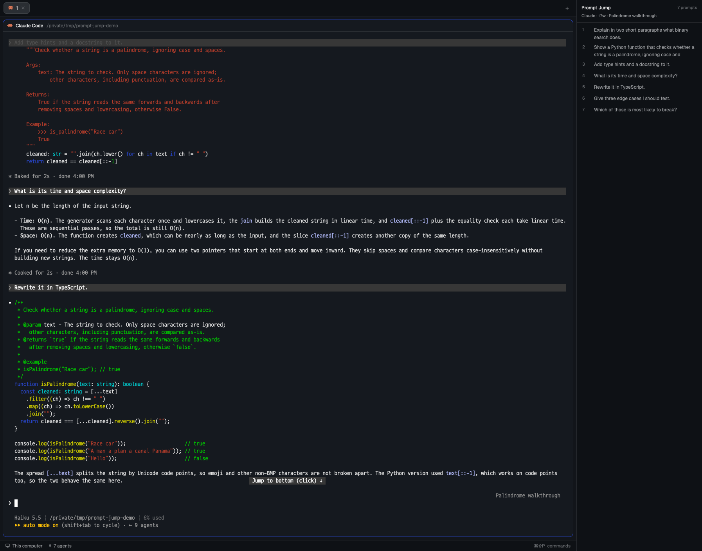

# herdr-prompt-jump

A [Herdr](https://herdr.dev) app panel that lists the prompts you typed into the focused agent session and scrolls the terminal to one when you click it. It works with Claude Code and [omp](https://github.com/can1357/oh-my-pi).



## What it does

- **Follows focus.** The panel shows the session of the Claude Code or omp terminal you last focused. Clicking the panel or a plain shell keeps the last session on screen.
- **Lists only what you typed.** Tool results, system reminders, injected context, slash-command output and the summary Claude writes after a compaction are left out. Prompts dropped by a rewind or an edited resend are left out too. Only the branch on screen is listed.
- **Jumps on click.** The prompt you click is brought into view in its terminal:
  - **omp**: Herdr's view of the terminal history scrolls so the prompt sits at the top (about 10 ms).
  - **Claude Code** (fullscreen TUI): the program's own view is paged with PageUp/PageDown from whichever is nearest: where the screen is now, the top or the bottom. Each page takes about 40–50 ms.
- **Stays current.** The list reloads while the agent works and when its turn ends.

## Install

Requirements: the Herdr desktop app and `node` on the `PATH` the app runs programs with.

```sh
git clone https://github.com/doominkim/herdr-prompt-jump
cd herdr-prompt-jump
./install-mod.sh
```

The mod installs to `~/.config/herdr-app/mods/prompt-jump` with `"place": "none"`, so add it to your layout yourself. For example, add a block to the root row of `layouts/<your-layout>.json`:

```json
{ "id": "prompt-jump", "type": "block", "size": { "px": 320 }, "min": 220, "max": 560,
  "content": { "mod": "prompt-jump" } }
```

and a toggle key to `keys.json` (as in this repo's `keys.json`):

```json
{ "global": { "f7": "layout.toggle:prompt-jump" } }
```

Shipped layouts are read-only: clone one first (`herdr-app do layout.clone '{"name":"main","as":"my-main"}'`).

## How a session is found

| Agent | Terminal → session file |
|---|---|
| Claude Code | The foreground process id → `~/.claude/sessions/<pid>.json` → `sessionId` → `~/.claude/projects/*/<sessionId>.jsonl` |
| omp | omp keeps no pid record. It takes the session files under `~/.omp/agent/sessions/` written since the process started, whose header `cwd` is the process's folder, and prefers the one whose title is in the terminal title. Otherwise it takes the newest. |

Prompt filtering follows [Illithid](https://github.com/doominkim/illithid)'s transcript reader.

## Limits

- **Claude Code needs the fullscreen TUI to jump by paging.** Without it, the jump falls back to Herdr's terminal history like omp. This costs one extra short wait.
- **Claude Code doesn't draw what came before a compaction.** Those prompts are listed dimmed as `compacted` and report that instead of paging.
- **Old omp prompts can scroll out of the terminal history.** herdr-core keeps a bounded scrollback (`history_mb` in `~/.config/herdr-core/config.toml`). A prompt that is no longer there shows a notice.
- **A prompt is matched on screen by its first 40 characters**, at the start of a prompt line. Prompts that start the same way are told apart by their order. Pasted content can render differently from the saved text and may not be found.
- **Two omp sessions in the same folder with the same title** can be confused.
- Clicking a Claude Code prompt sends `ctrl+home`/`ctrl+end`/`pageup`/`pagedown` to that terminal. They move its view, not its input.

## Files

- `mods/prompt-jump/main.js`: the panel.
- `mods/prompt-jump/jump.js`: finding a prompt on a terminal and scrolling to it. Pure: it takes `hc`, `sleep` and `scroll` as arguments.
- `mods/prompt-jump/prompts.mjs`: run with node. Resolves the session file and lists its prompts. `node prompts.mjs locate <terminal> <n>` runs a jump from a shell.

## License

MIT
