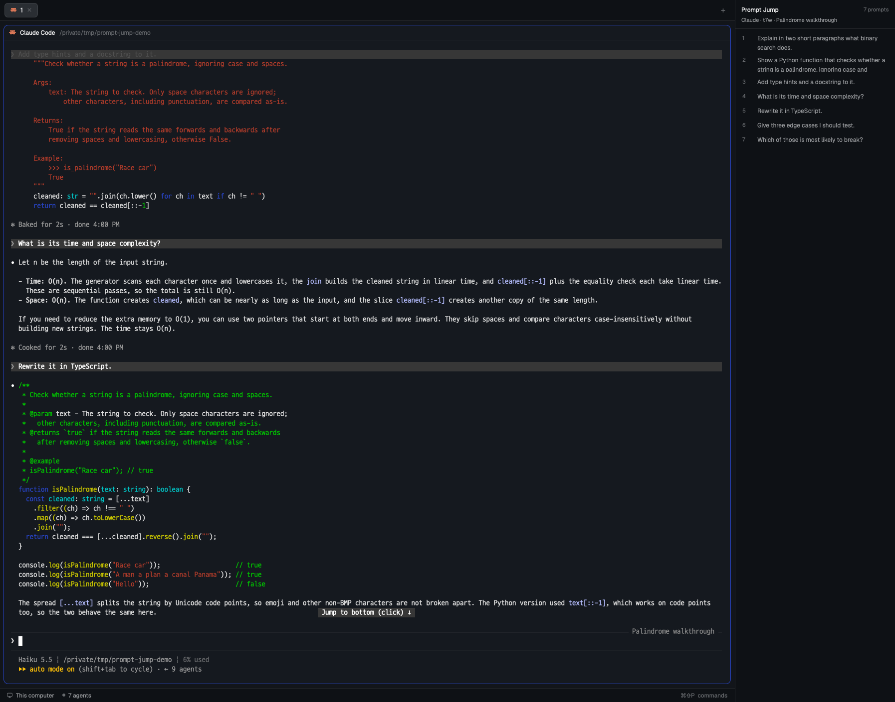

# Prompt Jump

A panel beside the terminals that lists, oldest first, the prompts the person typed into the focused Claude Code, Codex or omp session. Clicking one scrolls that agent's terminal so the prompt is in view.

## What you see

- A block about 320px wide (min 220, max 560) on the `chrome` background, toggled with F7 (`layout.toggle:prompt-jump`).
- Header (12px horizontal, 10px top / 8px bottom padding, 1px `border` bottom edge):
  - "Prompt Jump" (12px, semibold, `foreground`), with the count on the right ("7 prompts", 11px, `dim`). While reading it says "Reading…". While jumping it says "Jumping to #N…" in `accent`.
  - Below, one truncated 11px `muted` line: `Claude · t7 · <terminal title>` or `omp · t7 · <terminal title>`.
  - When another agent is focused: "<agent> is not supported yet (Claude Code, Codex and omp only)" (11px, `dim`).
- Search: under the header (12px horizontal, 8px vertical padding, 1px `border` bottom edge), a 28px `Input` on `raised` with a 1px `border`, 6px radius, placeholder "Search prompts…". It is shown when there are prompts. While searching, the count reads "3 of 100". With no match the list says "No prompts match the search".
- List: a `v_virtual_list` of 44px rows with a `Scrollbar`, tracked by a `VirtualListScrollHandle`. Each row has 12px horizontal and 5px vertical padding and an 8px gap:
  - The number (22px column, 11px, `dim`). The clicked row's number is `accent`. While that row is jumping, the number is a braille spinner (`.frames`, 80ms).
  - The prompt with whitespace collapsed (12px, `muted`, at most 34px tall, i.e. about two lines, overflow hidden).
  - A 2px left border, `accent` on the clicked row and `chrome` otherwise. The clicked row also has a `selected` background. Rows get the `hover` background on hover.
  - Claude prompts from before a compaction: `dim` text and a small "compacted" tag (10px, `raised` background, 4px radius).
- Empty states (12px, `dim`, 12px padding): "Focus a Claude Code, Codex or omp terminal to list its prompts here", "No prompts yet". Errors such as "No session file found for this terminal" appear in `blocked`.

## How it behaves

- Every 800ms it checks `focused().terminal` and follows it only when focus has moved. A newly focused terminal whose agent is Claude Code, Codex or omp becomes the panel's session. Anything else keeps the last session: a shell, this panel itself (clicking it makes `terminal` null) or another mod. A terminal opened on request (`prompt-jump.open`) therefore stays until focus moves.
- Claude Code and Codex: every 350ms the panel reads the session's screen (plain `hc read`, transcript rows = all but the last 6). When the screen changed, it highlights the prompt being read (`jump.js` `spyActive`) and centers its row:
  - Placing lines: consecutive request lines are consecutive prompts. A line matching exactly one prompt anchors the lines around it, so identical prompts get their place.
  - At the bottom, it is the latest prompt, even with its line scrolled off. The same words away from the input are transcript:
    - Claude is scrolled up only when "Jump to bottom" (`: fn+↓` or ` (click) ↓`, by version) appears within the 3 rows above its input box, which sits between the last two `─` separator rows.
    - Codex is scrolled up only when "↓ Back to bottom · esc" ("New activity · " before it while working) appears within the 3 rows above its input, which starts on the last row beginning with `›`. Codex also pins the request whose answer is at the top of the view to the first row.
  - If the latest prompt is on screen, it is the latest.
  - Otherwise, the last request line in the top half.
  - Otherwise, with request lines only in the bottom half, the prompt before the first one.
  - With none on screen, the highlight stays.
  - Compacted Claude prompts don't count, since they are not drawn.
  - After a jump, the spy waits until the screen differs from the one the jump left.
- omp: Herdr exposes no history scroll position to mods, so the highlight is the last prompt jumped to.
- Search keeps the prompts containing every whitespace-separated word of the query, ignoring case (`search.js`). It is cleared when the session changes.
- A row's `tooltip` is the first assistant text after that prompt, up to 280 characters plus "…". Tool calls are skipped; a prompt not answered yet has none.
- Keys and open requests go through shared state, which every 120ms timer tick reads, because a hidden panel doesn't render but its timers run:
  - The relay copy (`props.role: "relay"`, an empty floating block) takes `prev`/`next` from `nextCommand()` and writes `prompt-jump.step` `{dir, n, at}`. It beats `prompt-jump.relay` `{at}` every 30s.
  - Each panel copy beats `prompt-jump.panel` `{at}` every 10s from its start and clears it on close. With no beat within 25s, the relay adds `wake: true` to the step and runs `layout.show {id: "prompt-jump"}`. The copy that starts takes a waking step younger than 5s (`relay.js` `waking`), once its first list has loaded. Any other step written before a copy started is not for it.
  - A shown panel acts on its own `nextCommand()` only when no relay has beaten within 75s.
  - `prompt-jump.open` `{terminal, n}` from another mod selects that terminal and runs `layout.show {id: "prompt-jump"}`.
- The list reloads when the session's agent status changes, and every 4s while it is `working`.
- Clicking a row jumps (one jump at a time; later clicks are ignored until it ends):
  - First, Claude Code and Codex: page their full-screen view (Codex's prompt marker is `›`). If the target is not unique or no request on screen says which way to go, start from the nearer end (`ctrl+home` if it is in the first half of the on-screen prompts, else `ctrl+end`). Then step `pagedown`/`pageup`, counting matches only in the rows that scrolled in. If neither the keys nor the anchor move the screen, fall back to history.
  - History (omp, or a Claude Code without fullscreen): read the terminal with `hc read --lines 100000`, find the prompt line, then `terminal.scroll {to: "bottom"}` and `terminal.scroll {lines: -(distance - rows + 3)}` so the prompt is near the top.
  - Not found shows a warning toast for 4s: "This prompt has scrolled out of the terminal history", "Could not find this prompt on screen", or, for compacted Claude prompts (no paging), "Sent before the conversation was compacted: Claude only shows what came after".
- `prompt-jump.prev` / `prompt-jump.next` (bound to `cmd-shift-up` / `cmd-shift-down`) arrive through `nextCommand()` and step from the last prompt jumped to (`jump.js` `neighbor`). With none, prev goes to the latest prompt and next does nothing. The ends stop, and compacted Claude prompts are skipped. The list scrolls the row to its center (`scroll_to_item(i, "center")`). When the list grows by a new prompt, stepping starts from the bottom again. Only a shown panel gets these commands.
- A prompt line is the prompt's first 40 characters, with whitespace collapsed. It starts right after the program's prompt marker (`❯` for Claude Code, only indentation for omp), so the same words inside an answer don't count.

## Built from

- One block in the person's layout: `{ "id": "prompt-jump", "type": "block", "content": { "mod": "prompt-jump" } }`. `mod.json` is `{ "place": "none" }`.
- `main.js`: the `View`. Rows have no handlers of their own: a virtual list takes one `on_item_click`, keyed by prompt index. It uses `focused()`, `terminals()`, `agents()`, `theme()`, `run("terminal.scroll", …)`, `notify(…)`, `exec("node", [prompts.mjs, "prompts", <terminal>])` for the list, the built-in `hc([...])` for jumps, and `cx.sleep`.
- `jump.js`: pure jump logic taking `{ hc, sleep, scroll }`, used by the panel and by `prompts.mjs locate`.
- `prompts.mjs` (node):
  - Resolving the session: `hc get <t> --json` gives `foreground.pid`, `cwd`, `title` and `status.app`.
    - Claude: `~/.claude/sessions/<pid>.json` holds `sessionId`, and the transcript is `~/.claude/projects/*/<sessionId>.jsonl`.
    - Codex: the `rollout-*.jsonl` under `~/.codex/sessions` that a process in the terminal's tree has open (`pgrep -P` recursively, `lsof -Fn`). Otherwise the newest rollout since the process started whose first-line `session_meta.payload.cwd` matches. Prompts are `response_item` user messages; the duplicate `event_msg` `user_message` is ignored.
    - omp: the `~/.omp/agent/sessions/*/*.jsonl` files modified since the process started (`ps -o etime=`, minus 60s) whose line-2 header `cwd` matches. Prefer the one whose line-1 `title` is inside the terminal title, else the newest.
  - Filtering: Illithid's `cleanUserText` (strip `<system-reminder>`; drop injected prefixes such as `<task-notification`, `Caveat:`, `<local-command-stdout`; slash commands as `name args`; pasted content as `[pasted content] …`). Plus `isMeta`, `isSidechain` and `isCompactSummary` lines are dropped, and synthetic omp messages too.
  - Active branch:
    - Claude: walk `parentUuid` (or `logicalParentUuid` across a compaction) back from the last line that has a `uuid` of any type, and reverse. Every prompt before a `system`/`compact_boundary` line is `compacted`.
    - omp: walk `parentId` from the last entry.
  - A prompt sent from another terminal with `hc send` is saved and drawn as `<hc from="t7">…</hc>`. The list shows it unwrapped, but the screen key keeps the wrapper.

## Watch out

- `hc read --lines N` on a full-screen program costs about 1.2s for Claude and about 7s for Codex (herdr-core collects the program's own history; Codex answers `how: "stitched"`). So Claude Code pages first and reads history only as a fallback, and the paging reads use plain `hc read`.
- `hc keys` paces keys at about 33ms each. Sending several keys in one call is no faster than separate calls.
- When the app first sees a mod folder without `mod.json`, it docks a copy into the layout by itself. Install the folder whole (`install-mod.sh` builds it aside, then moves it).
- Run node by name through `exec`. The app's environment must have it on `PATH`.
- A hidden panel copy starts only the first time it is shown after the app or the mod loads. That is why the relay shows it on a key when no panel beats.
- Inside a virtual list's row renderer, `on_click` throws; `tooltip(text)` (a string) is fine.
- `pane.focus` from a shell races the person using the window. Don't script screenshots of the panel while someone works in it.

## Done when

- Focusing a Claude Code terminal lists its prompts. Rewound and compaction-summary messages are not in the list, and pre-compaction prompts show "compacted".
- Clicking the panel itself keeps the list.
- Clicking a Claude Code prompt one page away lands it on screen in under 100ms. A compacted one warns at once without paging.
- Clicking an omp prompt still in history scrolls it to the top of the view.
- Two identical prompts ("ok" twice) each jump to their own place.
- With the panel shown, `cmd-shift-up` from the bottom jumps to the latest prompt and highlights it, and the next press goes one earlier.
- With the panel hidden and not yet shown since the app started, `cmd-shift-up` shows the panel and steps the focused session. With it hidden after that, `cmd-shift-up` steps without showing it, and opening the panel shows the stepped row.
- `setShared("prompt-jump.open", {terminal, n})` from another mod shows the panel with that terminal while focus stays put.
- Scrolling a Claude Code terminal up moves the highlight to the prompt whose answer is in view.
- Typing two words in the search keeps only prompts containing both.
- `node --test 'test/*.test.mjs'` passes.
- `herdr-app check ~/.config/herdr-app/mods/prompt-jump` passes.
